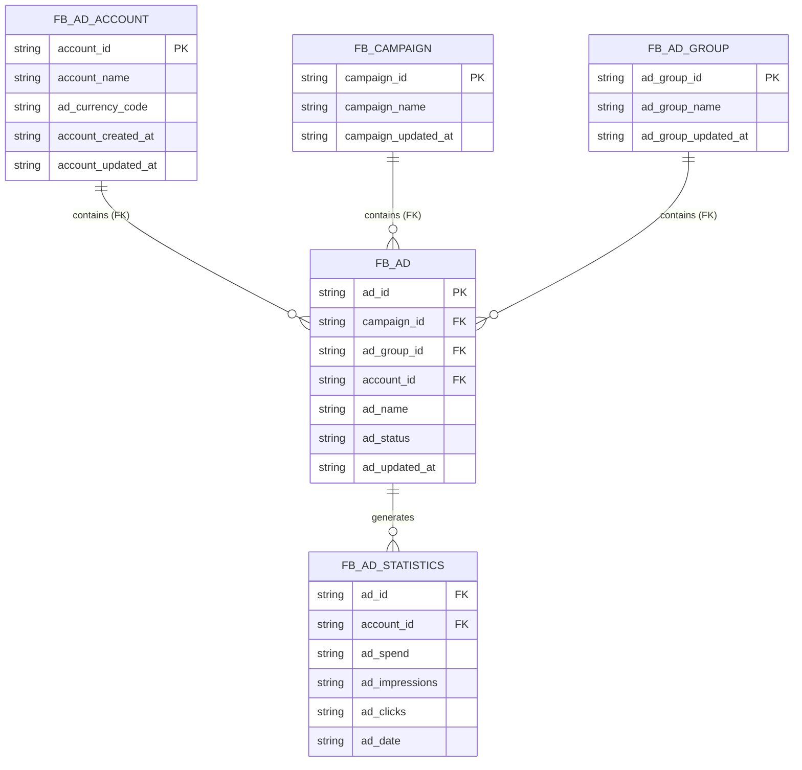
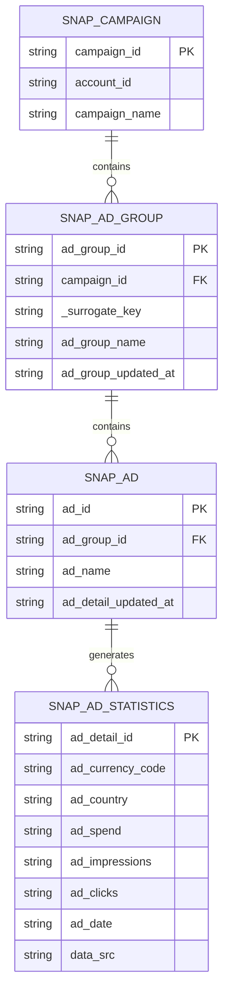

## Business/Data Understanding

We have two data sources:

- Facebook Ad Data
- Snapchat Ad Data

## Understanding Facebook Ad Data

Facebook’s data is structured around a central Ad Bridge model, following the Star Schema. Because upstream entities like campaigns and ad groups are isolated in their own tables, the individual Ad acts as the master connector holding all parent keys:

- **Account** (`FB_AD_ACCOUNT`): The top-level container holding account metadata, names, and currency codes.

- **Campaign** (`FB_CAMPAIGN`): The top-level marketing container holding campaign names and update timestamps.

- **Ad Group** (`FB_AD_GROUP`): The mid-level container holding ad group names and update timestamps.

- **Ad** (`FB_AD`): The central bridge. It holds ad_id and contains the foreign keys pointing upward to its parent account_id, campaign_id, and ad_group_id all in one place.

- **Stats** (`FB_AD_STATISTICS`): The performance/fact table. It contains daily metrics (ad_spend, ad_impressions, ad_clicks) at the grain of a specific ad on a specific date (ad_id + ad_date), linking directly back to the ad and account.

The Entity Relationship Diagram (ERD) is as follows:

## Understanding Snapchat Ad Data

Unlike Facebook, Snapchat follows a cleaner, strict hierarchical chain from top to bottom. Here is how they link together:

- **Campaign** (`SNAP_CAMPAIGN`): The top-level container. It holds the campaign_id, account_id (linking it to the ad account), and campaign_name.

- **Ad Group**(`SNAP_AD_GROUP`): The mid-level container. It holds ad_group_id and has a foreign key campaign_id that points directly up to the campaign.

- **Ad** (`SNAP_AD`): The creative level. It holds ad_id and has a foreign key ad_group_id that points directly up to the ad group.

- **Stats** (`SNAP_AD_STATISTICS`): The performance/fact table. It contains daily metrics (ad_spend, ad_impressions, ad_clicks) at the grain of a specific ad detail on a specific date.

The Entity Relationship Diagram (ERD) is as follows:

## Concept Bank

- Dimension Tables (`CAMPAIGN`, `AD_GROUP`, `AD`) represent things or entities.
- Fact Tables (`AD_STATISTICS`) represent events or measurements over time (transactions)